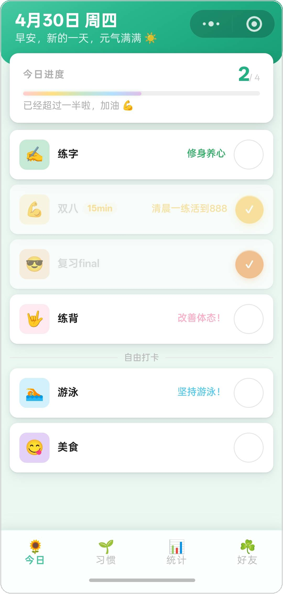
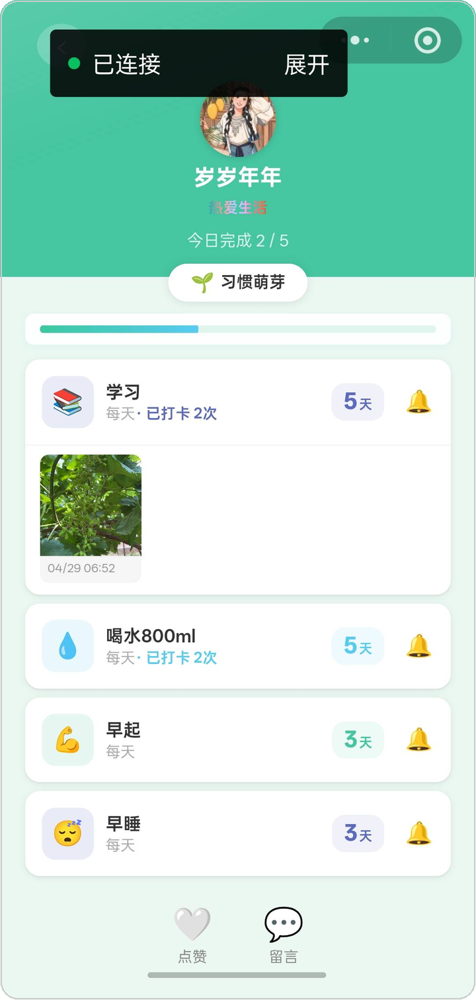
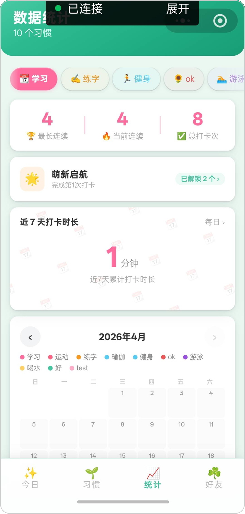
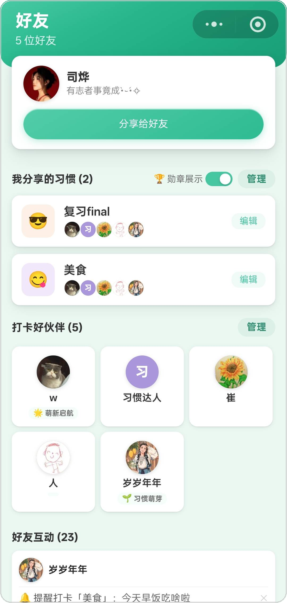
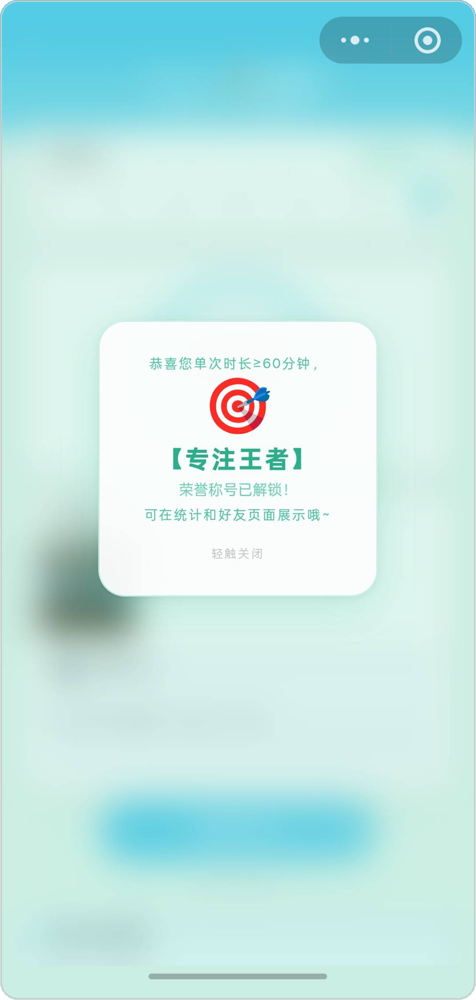

# Xiaoka · 小卡

**Keep track of your daily habits with your friends.**

A WeChat Mini Program for building habits together — check in daily, track your streaks,
and stay accountable with the people around you.

---

## ✨ Features

- **Daily check-in** — a focused "Today" view showing exactly which habits are due, with one-tap check-in.
- **Habit management** — create habits with an emoji, color, and weekly frequency; edit or archive them anytime.
- **Streaks & stats** — completion rates, current streak, and per-habit history at a glance.
- **Friends & accountability** — add friends, browse their habits, and keep each other honest.
- **Reminders** — scheduled cloud functions send check-in nudges so you don't forget.
- **Share cards** — generate a Mini Program code to invite friends in one scan.
- **Inbox** — friend requests and system messages in one place.

## 📱 Screenshots

  
  &nbsp;
  
  &nbsp;
  
  &nbsp;
  
  &nbsp;
  

## 🧱 Built with

| Layer | Choice |
| --- | --- |
| Client | Native WeChat Mini Program (WXML / WXSS / JavaScript) |
| Backend | WeChat Cloud Development (cloud functions + cloud database) |
| Auth | `wx.cloud` built-in OpenID, no separate account system |
| Data | Cloud database collections for habits, check-ins, and profiles |

## 📄 License

Released under the [MIT License](LICENSE).

---

A product showcase — the Mini Program is not open for external development.

